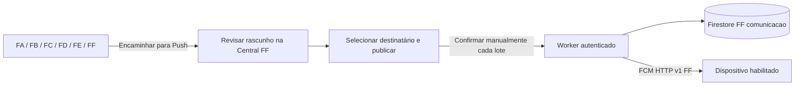

# Central de Comunicação — FF

Branch `codex/central-comunicacao-ff`. O histórico de implementação abaixo é complementado pelo registro de implantação ao final. Não houve envio real de Push. O provisionamento administrativo solicitado para `anestesiahmtforms6@gmail.com` foi aplicado separadamente nos seis projetos.

## Configuração preservada e verificação real

| Campo | Valor |
| --- | --- |
| Projeto | `sahmt-comunicacao-ff` |
| App nomeado | `sahmt-ff-direct` |
| App ID | `1:772883283859:web:9e26ccec85366db0e53266` |
| Sender ID | `772883283859` |
| Auth | `sahmt-comunicacao-ff.firebaseapp.com` |
| Firestore | `comunicacao`, `southamerica-east1` |

A API em 03/11/2026 confirmou `billingEnabled: false`, ausência de conta de faturamento, `freeTier: true` e um único banco, `comunicacao`. A hipótese inicial de cobrança foi corrigida antes de qualquer alteração. O usuário determinou preservar esse banco. Não criar `(default)`, excluir banco ou habilitar Blaze. `node scripts/inspect-ff.mjs` repete as verificações sem emitir tokens. Também confirmou identidade Google verificada e perfil ativo dos quatro administradores em FA/FF.

## Arquitetura e funcionamento

GOVERNANÇA mostra a Central somente para os quatro e-mails autorizados. O menu oferece criação, rascunhos/publicações, encaminhamento, envio, destinatários/grupos, histórico/auditoria, indicadores e configurações. Usuários comuns acessam mensagens elegíveis e inscrição pelo botão na Home.

Encaminhamento usa a URL canônica do aplicativo. Comunicados FA/FB possuem atalho no próprio registro. Nos demais contextos, o formulário recebe a instância e permite informar o identificador de uma coleção autorizada. O servidor verifica a referência, sem alterar a origem. Ocorrências, indicadores e pesquisas geram texto genérico para redação institucional; não copiam dados sensíveis. Publicar não envia Push. Datas futuras limitam visibilidade, sem agendar envio.

EQUIPE, RESIDENTES e SUBSTITUTOS são grupos institucionais distintos e imutáveis. O servidor resolve o usuário FB por e-mail único, confirma perfil ativo e consulta `userCategories` vinculado à identidade. `EFETIVO` corresponde a EQUIPE; `RESIDENTE_1/2/3`, RESIDENTES; `SUBSTITUTO`, SUBSTITUTOS. Ser administrador/gestor não atribui grupo. Grupos personalizados aceitam até 100 pessoas; área usa associação vigente em FB. Seleção individual resolve o cadastro FA e dispositivos FF sem equiparar seus UIDs.

## Segurança e armazenamento

- Backend exige tokens FA e FF confirmados pelo Google, e-mail verificado, conta ativa (também nos dois projetos antes de enviar a cada destinatário), projeto correto e mesmo identificador imutável do provedor Google. FF pode ter UID diferente. O contrato anterior FA–FE permanece.
- Administração exige perfil FA ativo/aprovado e um destes e-mails: `wx2064@gmail.com`, `anestesiahmtforms@gmail.com`, `anestesiahmtforms6@gmail.com`, `marcio.henrique82@gmail.com`. Permissões locais e parâmetros do navegador não concedem acesso.
- Regras FF negam leitura e escrita direta a qualquer cliente, inclusive administrador. O Worker usa IAM e aplica autorização por ação. A própria identidade registra/desativa seus dispositivos; tokens não são expostos nas consultas.
- Limite de cinco dispositivos ativos. Inscrições com mais de 30 dias sem renovação e tokens `UNREGISTERED` são desativados no processamento. Habilitar novamente renova a inscrição; registros desativados liberam vagas.
- `PREPARE` não envia. `SEND_BATCH` exige confirmação, versão e reserva transacional. Lotes de até três dispositivos candidatos não são repetidos por concorrência. Interrupções podem ser reconciliadas após dois minutos, marcando resultado incerto sem reenvio.
- Aceite FCM não comprova entrega. Falhas, ignorados e resultados incertos são separados. Prévia na tela bloqueada é genérica. O service worker existente aceita apenas módulos conhecidos na mesma origem.
- Auditoria registra UID FF, UID FA de origem, e-mail, instante, ação, versão e resultado, sem token de dispositivo. Alterações de mensagem/grupo preservam o registro auditado.

Coleções FF: `communicationMessages`, `communicationRecipients`, `communicationDevices`, `communicationGroups`, `communicationDispatches`, `communicationAuditLogs`, `communicationSettings`, `communicationMetrics`, `communicationBudgets`, `communicationRateLimits`. A Central só lê FA–FE. A alteração administrativa autorizada para a conta nova é uma operação separada.

Não há listeners permanentes. Listas administrativas paginam 20 registros. A caixa de entrada lê cinco candidatos e filtra audiência no servidor; uma página vazia pode ter continuação. Indicadores são agregados por total/mês. Respostas são `no-store`; a Central não persiste dados privados no cache do navegador e suspende requisições em segundo plano.

## Limites e faturamento

Limites conservadores da aplicação: 200 operações autenticadas por dia UTC para toda a Central, 20 por minuto por UID e 44 chamadas externas por requisição. Excesso retorna erro explícito. Outros módulos compartilham cotas dos respectivos projetos/contas; esses limites não reservam cota global.

Workers Free publica limites de 100 mil requisições/dia, 50 subrequisições/invocação e 10 ms de CPU. A conta disponível retornou `default_usage_model: standard`, o que não comprova Free; consulta de assinaturas retornou 403 por falta de acesso de faturamento. **O plano gratuito ainda precisa ser confirmado antes de implantação.** `WORKERS_FREE_CONFIRMED=false` bloqueia operação. CPU real de OAuth/Firestore deve ser homologada no Free; testes locais não comprovam esse limite. Não contratar plano pago caso o fluxo não caiba.

## Configuração e liberação

1. Repetir `node scripts/inspect-ff.mjs`; exigir banco `comunicacao` gratuito, ausência de faturamento e quatro identidades válidas.
2. Confirmar Workers Free na conta de destino, sem alterar plano. Manter desabilitado se a confirmação não for possível.
3. Preparar exclusivamente `communication-worker@sahmt-comunicacao-ff.iam.gserviceaccount.com`: acesso de dados FF, envio FCM FF, consulta de usuários Auth FA/FF e metadados do banco/projeto; somente leitura de Firestore FA–FE. A consulta de faturamento requer `resourcemanager.projects.get`. Não conceder Owner/Editor ou escrita FA–FE. IAM não limita acesso por coleção; a lista fixa do Worker também é necessária.
4. Guardar o JSON administrativo exclusivamente no secret `FF_SERVICE_ACCOUNT_JSON` do Worker. Nunca em `VITE_*`, arquivos públicos, logs, PR ou service worker. Na implantação foi criada uma chave da conta de serviço, guardada por DPAPI fora do Git e instalada somente como secret no Worker.
5. Após revisão, publicar regras/índices por `firebase deploy --config firebase.ff.json --project sahmt-comunicacao-ff --only firestore`. A configuração mantém `comunicacao` e não contém Functions.
6. Obter a chave **pública** VAPID/Web Push de FF. Tokens são gerados pelo app Messaging FF existente. Configurar `VITE_COMMUNICATION_FF_ENDPOINT` com URL HTTPS `workers.dev` terminada em `/v1/communication`, `VITE_COMMUNICATION_FF_VAPID_KEY` e, apenas na homologação, `VITE_COMMUNICATION_FF_ENABLED=true`.
7. Implantar Worker somente após confirmação Free, com `COMMUNICATION_ENABLED=true` e `WORKERS_FREE_CONFIRMED=true`. CORS aceita exclusivamente `https://anestesiahmtforms.github.io`.
8. Habilitar envio nas Configurações. Testar primeiro **uma pessoa e um aparelho autorizado**, permissão explícita e PWA fechado. Conferir aceite FCM, notificação visual e clique. Testar Android, desktop e iPhone instalado na Tela de Início (iOS/iPadOS 16.4+). Não realizar envio para todos nos testes.
9. Validar conta revogada/usuário comum bloqueados, consumo/CPU Free e recuperação de lote interrompido antes de ativação geral. Reversão: desligar envio e flags do Worker/frontend, preservando auditoria.

## Conta administrativa solicitada

Em 03/11/2026, `anestesiahmtforms6@gmail.com` foi provisionado em Auth e `users` de FA, FB, FC, FD, FE e FF após confirmação Google por OAuth. Criados seis usuários com um UID novo comum e 12 documentos: seis perfis, cinco acessos institucionais a documentos e um acesso gestor Qmentum FC. Usuários preexistentes, IAM, provedores, faturamento e regras desses projetos foram preservados.

`node scripts/provision-communication-admin.mjs verify` confirmou seis contas ativas/vinculadas e zero alterações de perfil pendentes. O script é fixo para esse e-mail: `preview` não escreve; `apply` usa precondições e recusa conflitos. Backup e plano de alteração ficam cifrados por DPAPI em `SAHMT/communication-admin` na pasta local do usuário Windows, fora do Git. O titular ainda deve conferir o login pela interface. A liberação é do aplicativo, sem propriedade IAM dos projetos.

## Testes e pendências

- Suíte geral: 1.180 testes aprovados.
- Central: testes de audiência, identidade, destinatário individual/grupos/áreas, dispositivo expirado, substituição de aparelho, auditoria, quotas, concorrência e recuperação sem duplicidade.
- `workerd`: Worker real com Google/Firestore/FCM simulados; autenticação, gravações exclusivas FF, envio individual, bloqueios e teto de chamadas. Não comprova entrega FCM real.
- Playwright/Edge: interface administrativa/comum, três grupos, seleção individual, publicação sem envio implícito, encaminhamento, confirmação manual e texto escapado; larguras 320, 390, 768 e 1440 px sem overflow.
- Emulador Firestore: bloqueio de leitura/listagem/escrita direta para perfis, administradores e não autenticados.
- Builds independentes FA/FB/Enquetes, inclusive Central habilitada para compilação local; Worker empacotado com `wrangler deploy --dry-run`, sem publicação.

Comandos: `test:communication`, `test:communication-browser` (Vite local porta 5178), `test:communication-rules` (Java) e `build:communication-worker`. Na instalação pnpm estrita desta máquina, a suíte legada `evaluation-data` usou `NODE_PATH` para o `esbuild` transitivo; nenhuma dependência de produção foi adicionada.

Pendências para produção: comprovar Workers Free; configurar IAM/secret/VAPID/endpoint; implantar regras/índices/Worker após homologação; testar Push real individual em iPhone/Android/desktop e CPU Free. Não afirmar entrega ou funcionalidade publicada com base nos testes simulados.

O PR #151 foi revisado. Sua proposta de Cloud Functions em FA não foi integrada por conflitar com FF e a restrição de faturamento. Esta proposta é independente, sem merge/publicação na `main`.

Referências: [Workers](https://developers.cloudflare.com/workers/platform/limits/), [Firebase](https://firebase.google.com/pricing), [FCM HTTP v1](https://firebase.google.com/docs/cloud-messaging/send/v1-api), [consulta de faturamento](https://cloud.google.com/billing/docs/reference/rest/v1/projects/getBillingInfo), [importação Auth](https://cloud.google.com/identity-platform/docs/reference/rest/v1/projects.accounts/batchCreate), [Web Push iOS](https://webkit.org/blog/13878/web-push-for-web-apps-on-ios-and-ipados/).

## Implantação FF — 03/11/2026

O usuário confirmou Workers Free da conta FF `7c4c3dcb7472c5daa58620efd358dfb1`, com titular `anestesiahmtforms6@gmail.com`. A conexão genérica da conta FA foi descartada; a implantação usa o perfil local `sahmt-ff-isolation`, com identidade e conta verificadas por API. Worker: `sahmt-ff-comunicacao`; endpoint: `https://sahmt-ff-comunicacao.anestesiahmtforms6.workers.dev/v1/communication`.

Regras e índices publicados no banco FF `comunicacao`. Criada conta de serviço `communication-worker@sahmt-comunicacao-ff.iam.gserviceaccount.com`, com papéis personalizados: dados e transações FF, FCM FF, consulta de Auth FA/FF, metadados FF e somente leitura dos documentos FA–FE. Políticas anteriores e chave privada protegidas por DPAPI fora do repositório. Nenhuma permissão Owner/Editor ou de cobrança foi atribuída ao serviço. A API Cloud Billing foi habilitada apenas para a consulta de metadados de faturamento pelo serviço, sem vincular conta ou habilitar Blaze.

Os scripts `prepare-communication-production.mjs --apply` e `deploy-communication-production.mjs --apply` usam o destino fixo e verificam identidades. A ativação do backend usa flags explícitas no comando de implantação; os valores locais padrão continuam desativados. O secret foi instalado e o endpoint real confirmou negação HTTP 401 de requisição sem autenticação. Transação FF e consulta de dispositivos foram verificadas com a conta de serviço real; nenhum aparelho estava inscrito.

A chave VAPID pública fornecida pelo usuário e o endpoint FF foram incluídos no workflow de publicação. A chave pública pode constar na build; a privada permanece fora do cliente. Encaminhamentos leem somente campos de texto permitidos ou `updatedAt` na origem, evitando carregar snapshots grandes e dados pessoais desnecessários.

Pendências de homologação em aparelho: login real FA/FF, inscrição voluntária de um dispositivo, consumo de CPU no Free e envio manual individual com PWA fechado. `pushEnabled` permanece false até ação explícita de administrador nas Configurações. Os testes locais não comprovam entrega real ou compatibilidade visual em iPhone/Android. Antes do teste, fechar clientes antigos para ativar o novo service worker.

## Correção de ativação no iPhone

O atalho global foi retirado da grade principal da Home: adicioná-lo como filho direto criava uma linha grande e comprimia os módulos. A solicitação agora é um banner compacto na área de módulos, com destaque dourado/selo NOVO e entrada breve respeitando movimento reduzido. O título Push genérico passa a “🔔 SAHMT · NOVO AVISO”; apresentação nativa continua controlada pelo iOS.

A Central espera a restauração coordenada da sessão FF. Se faltar a sessão no navegador, exibe o botão Google oficial na própria tela e, após confirmar a mesma identidade, repete somente BOOTSTRAP. Não repete escritas ou envios e não cria contas. A recuperação substitui o carregamento inicial e mantém o botão ao retornar do segundo plano.

Validação local: 1.180 testes gerais, 75 testes focados, 19 testes de Central/runtime/ciclo do cliente e quatro testes de navegador incluindo a Home real em 320/390/430 px e recuperação Google. Build e verificação de dependências aprovadas. O teste de entrega real continua pendente da inscrição do iPhone de wx2064@gmail.com.
