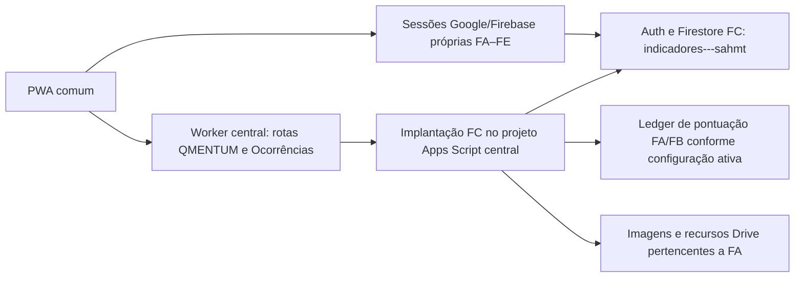
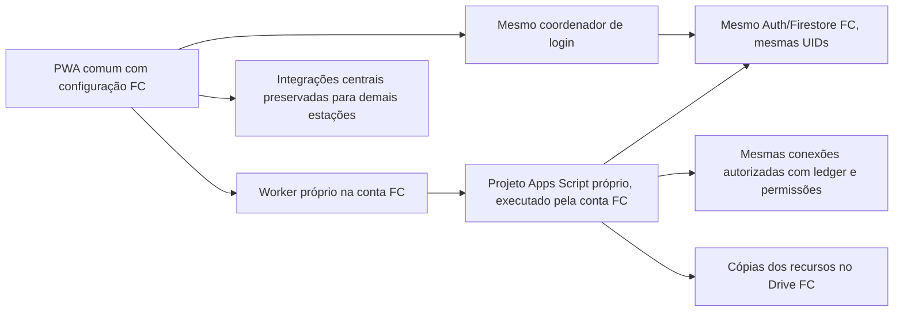

# Isolamento operacional de FC — diagnóstico e preparação

Estado: migração em andamento, sem troca em produção. Responsável por FC informado pelo usuário: `anestesiahmtforms3@gmail.com`. Data: 01/11/2026, America/Sao_Paulo.

## Recursos verificados

| Recurso | Identificador / evidência | Situação |
| --- | --- | --- |
| Código comum PWA | `anestesiahmtforms/SAHMT-V2.0.github.io`, revisão inicial `5bd3b44` | Clonado; branch local `codex/fc-integration-isolation` |
| Apps Script central | `1ReIZEXaVspXDYFP3u5g4pJNPKVOsrafNWACmsPVIbgq85Zav9sjkR4bD` | Identificado no Drive e editor; não modificado |
| Apps Script FC | `1rwJgnVjEmCoSfXlhIA-SNaCFOINIl_-O73CVn9D_aIBM60tI_qZnUtrI` | Criado por FC; 22 arquivos de preparação enviados e verificados; sem implantação pública ou segredos |
| Gateway histórico | `16Xhs_5KkWRt8xCxqH8cFrxEHSaeAs3A16WQA1o78FdUnxQsJG3QLICB4` | Encontrado no Drive; autenticação secundária do Worker central está desativada |
| Firebase FC | `indicadores---sahmt`, banco `(default)` | Confirmado no código comum e destinos dos relays; acesso administrativo atual não validado |
| Cloudflare central | `1851e9f4cd5f026371beaa2c5a85f1b8` | Consulta autenticada da sessão local Wrangler bem-sucedida |
| Cloudflare FC | `57b8b02c577b6f61e96a61ce44142d2e` | Sessão FC própria confirmada; Worker específico criado, desativado e sem URLs públicas |
| Drive destino FC | `1HKohx4MezyQC4tW2gim11ar_7OfmFtPc` | Propriedade FC confirmada; subpasta restrita criada e 20 cópias de entrada preparadas |

O link do painel Cloudflare identifica a conta e não é endpoint público da integração. O 403 não demonstra que a conta inexiste. Não criar outra conta como tentativa de corrigir a autorização.

Atualização: o perfil `sahmt-fc-isolation` confirmou a identidade `anestesiahmtforms3@gmail.com` e a conta FC existente. A captura do usuário em Workers plans mostra **Free, $0, Current plan**; o usuário também confirmou o plano gratuito. Nenhuma alteração de plano ou cobrança foi executada. Com inventário prévio vazio, foi criado `sahmt-fc-integration`, versão `80d0c9f1-2ae2-4481-bc4e-91407c4b82b8`, com todas as flags `false`, Workers.dev e previews desativados e zero agendamentos. O namespace SQLite próprio é `0db752efd43943838b3af89e0eabeafc`. O readback da API confirmou esse estado. A URL pública da integração ainda está pendente de configuração/validação; não se apresenta um endereço privado/desativado como integração operacional.

O inventário autenticado central identificou `sahmt-auth-broker`, `sahmt-auth-pilot`, `sahmt-html-training`, `sahmt-indicators`, `sahmt-label-ai` e `sahmt-operational-channel`. O broker usa Durable Object para admissão e não tem cron. Outras estações dependem desses recursos: preservá-los.

Arquivos de evidência locais estão em `../../fc-isolation/evidence/`: `cloudflare-inventory.json`, `drive-inventory.json` e `source-http-probes.json`. Esses arquivos não contêm valores dos segredos.

## Login automático atual

O mecanismo ativo no código é `src/google-project-auth-runtime.js` + `src/google-project-auth-adapter.js` + `src/google-project-auth-core.js`, habilitado por `VITE_GOOGLE_PROJECT_AUTH_ENABLED` no build. A manutenção na abertura/retorno é chamada em `src/main.js`. Os destinos estão em `src/google-project-auth-config.js`.

1. FA usa o projeto `sahmt-17a16`. Cada destino mantém uma instância Firebase Auth própria e a persistência do SDK (IndexedDB, localStorage ou memória).
2. Na abertura, o coordenador restaura as sessões existentes sem popup, nova credencial ou leitura Firestore para a restauração em si.
3. No login primário Google, a credencial Google temporária é reutilizada com `signInWithCredential` em destinos existentes. Não se reutiliza um token ID Firebase de FA como token de FC.
4. `verifyExistingGoogleDestination` precede a conexão. O código confere UID, identidade Google, `aud`, `iss` e provedor `google.com`; conta ausente/divergente é recusada.
5. Ocorrências e QMENTUM aguardam a sessão FC coordenada. Permissões de negócio são conferidas separadamente nos documentos e regras do destino. UID igual não concede autorização global.
6. O Worker central registra `MANAGEMENT_SECONDARY_AUTH_RETIRED=true` e flags de autenticação de FA/FB/FC desativadas. O gateway histórico não deve ser reativado para fazer este isolamento.

Isso é evidência de código e configuração de servidor. Login integrado no aparelho do usuário, expiração real e sessão em cache ainda precisam ser observados; não foram certificados por testes locais.

## Fluxo atual e proposto

A proposta reutiliza os relays e as regras de negócio existentes. Não altera Auth, regras Firestore ou dados de negócio durante a preparação. O Worker novo deve expor somente `/v1/qmentum/write`, `/v1/qmentum/prints` e `/v1/evaluation/occurrence`; nenhum endpoint novo de login ou de FA/FB.

## Dependências e limites

| Área | Componentes atuais | Tratamento |
| --- | --- | --- |
| QMENTUM comandos | `QmentumWrite.gs`, `QmentumCore.gs`, `QmentumQuarterly.gs`, `Config.gs`, `EvaluationLedger.gs` | Reutilizar validações, identidade, CAS e contratos assinados |
| QMENTUM imagens | `QmentumPrints.gs`, `QmentumPrintCore.gs`, `ServiceQuota.gs` | Copiar imagens; atualizar somente referências necessárias; OCR temporário precisa de destino privado FC |
| Participação/pontuação | `QmentumParticipation.gs`, `ManagementIndependentFb.gs`, ledger e helpers de entrega | Preservar recibos determinísticos e destino selecionado (FA/FB, configuração ativa ainda não lida); não mover ledger nem histórico |
| Ocorrências | `EvaluationOccurrenceHttp.gs`, `EvaluationOccurrenceDelivery.gs`, `EvaluationLedger.gs` | Preservar HMAC, antirreplay, evidência FC e crédito idempotente |
| Recepção HTTP | `OperationalSheetPush.gs` contém o `doPost` compartilhado | Extrair receptor FC com apenas quatro ações atuais; não copiar rota operacional FA |
| PWA | `qmentum-command.js`, `qmentum-print-client.js`, `occurrence-scoring-delivery.js` | Configurar endereço FC separado das planilhas operacionais FA |

O checkout local não era a fonte completa. A exportação real confirmou 79 arquivos na revisão atual e quatro implantações; foram protegidos os conteúdos publicados das versões 45, 54 e 55. O Worker central aponta para a versão 55. O pacote FC foi derivado dessa versão, com 107 declarações na análise conservadora de dependências dos três handlers, e recebeu entrada/configuração/preparação específicas. O inventário de propriedades e gatilhos reais ainda está pendente; não sobrescrever produção a partir do checkout.

O Apps Script exibiu registros `QMENTUM_PRINT_READ_CHECK` com status 429 e `SAHMT_URLFETCH_DAILY_QUOTA`. `ServiceQuota.gs` conserva uma pausa por usuário após reconhecer a exceção de cota. O registro é do guard; o evento original da exceção e o consumo agregado ainda precisam ser consultados nas execuções. As [cotas Apps Script são por usuário](https://developers.google.com/apps-script/guides/services/quotas): outro projeto executado pelo mesmo usuário não separa a cota diária de URL Fetch. A implantação e os gatilhos FC precisam executar efetivamente pela conta FC.

O limite diário de requisições do [Workers Free é por conta](https://developers.cloudflare.com/workers/platform/limits/). Workers separados na mesma conta não isolam esse limite. O plano FC foi confirmado como Free/$0 por captura do painel e resposta do usuário; nenhuma contratação, upgrade ou recurso pago foi habilitado. A API de assinaturas permanece inacessível pelos escopos OAuth atuais. A admissão usa SQLite Durable Objects, [disponíveis também no Workers Free](https://developers.cloudflare.com/durable-objects/platform/pricing/); o consumo deve ser acompanhado durante a validação integrada.

## Migração Drive identificada

| Origem | Finalidade | Inventário | Destino |
| --- | --- | --- | --- |
| `1wKCX9ZHPgZ3FPmHU_N12dNbAQ97BeelA` | Imagens de procedimentos/técnicas QMENTUM | 10 PNG; propriedade de FA; permissões inspecionadas individualmente | Pasta FC `1GVmQD2T2ITlSDqtS-KsrHs0_QorJk_xK`, cópias finais pendentes |
| `1-wPMVdon2pCjjariPqYZ6tsweinaf3bA` | Imagens de números de indicadores QMENTUM | 10 PNG; propriedade de FA; permissões inspecionadas individualmente | Pasta FC `1rpKUFmZ1sNZ1w31305kx48jW1WbEqSuI`, cópias finais pendentes |
| `1sL1NPK-CkZHmWJO_39MLajU-VpJIOZ74` | Pasta central APP SAHMT-V2.0 | Contém scripts, cadastro, relatórios e escalas compartilhados | Não mover integralmente |

Os 20 IDs, URLs, pais, proprietários e permissões originais estão no inventário JSON. As 20 cópias de entrada, dentro de FC, estão registradas em `drive-copy-staging.json`, com tamanho, checksum e propriedade FA verificados. A propriedade das cópias finais ainda precisa ser FC: a localização na pasta FC não comprova essa transferência. A função manual `organizarRecursosFcV1` cria cópias nativas pela conta proprietária FC, com trava exclusiva, conferência integral antes das mutações, retomada por appProperties e relatório sem segredos. Os originais e as cópias de entrada permanecem preservados.

O novo projeto precisa ser organizado na subpasta restrita `1hc8nHWMXAUbyU3TsmD_5TzBdJdNa5I5A`; a pasta principal mantém seu compartilhamento preexistente por link. OCR usará `1NbyfmHaAJs95fdaEvJw7uljcmcyYwZcS`. A instalação confere ACL completa, inclusive compartilhamentos nominais e grupos, antes de configurar o destino temporário.

A referência conhecida é `qmentumUnits/{unitId}/printConfig/current.folders.{TECHNIQUES,INDICATORS}`. Antes de alterar, capturar valor e `updateTime`, provar que os novos arquivos atendem à conta executora e registrar o par antigo/novo. Outros campos de proveniência de imagens e configurações de OCR devem ser descobertos no snapshot real. Não fazer substituição global de strings no Firestore.

Leitura administrativa FC confirmou uma unidade `sahmt` e as duas referências antigas no documento `printConfig/current`; nenhuma referência foi atualizada. O marcador `occurrenceRuntime/independentV1` está ACTIVE. A conta FC recebeu 403 ao consultar os marcadores de pontuação nos projetos FA/FB; os acessos necessários e o roteamento ativo do ledger precisam ser confirmados antes da validação integrada.

A troca dessas referências é global para clientes novos e antigos. Antes do corte, resolver e testar o acesso do executor central às cópias FC durante a janela de clientes antigos; hoje os diretórios finais são privados de FC. A reversão precisa preservar acesso a arquivos para ambos os executores enquanto versões do PWA ainda apontarem a endereços diferentes. Não aplicar o patch de referências antes dessa compatibilidade e do rollback serem demonstrados.

## Ativação e reversão

1. Obter acesso de escrita ao Drive FC e sessão Cloudflare da conta FC. Ler inventário e reutilizar Worker FC se houver. Confirmar plano sem habilitar cobrança.
2. Exportar código e versões atuais do Apps Script e inventariar nomes das propriedades, gatilhos e identidade efetiva. Backups de valores sensíveis devem ser protegidos; nunca incluídos no Git, documentos ou logs.
3. Criar/preparar projeto FC na conta responsável, copiar apenas dependências necessárias e configurar segredos próprios do par Worker↔Apps Script FC. Preservar contratos e os destinos Firestore existentes. Ainda não habilitar gatilhos.
4. Copiar recursos Drive, verificar estrutura, propriedade e acesso e completar a correspondência de IDs. Preparar patches Firestore restritos com precondição e patch inverso, sem executar antes da revisão.
5. Testar FC pelo PWA com a sessão real, tokens corretos e incorretos, permissões, renovação, gravações identificáveis, documentos e negação de acesso cruzado. Testar também FA/FB/FD/FE e clientes antigos.
6. Apresentar recursos reais, resultados e patches de ativação/reversão para a aprovação exigida pelo usuário. Somente então ativar endereços, referências e gatilhos FC; desligar apenas o processamento antigo exclusivo de FC.
7. Reversão: desabilitar somente gatilhos FC novos; retornar configuração de roteamento do PWA ao endereço anterior; restaurar somente referências com precondições verificadas. Manter Worker/Apps Script central disponíveis para clientes antigos. Não desfazer dados de negócio legítimos produzidos após o corte; reconciliar recibos/outbox existentes.

Rollback exige publicação da configuração anterior e atualização do shell pelo fluxo de cache já existente; desligar uma variável no servidor não reescreve bundles já instalados. Preservar endereços antigos durante a janela de compatibilidade. Nenhuma alteração de versão/service worker deve anteceder a publicação aprovada.

## Evidências e pendências

- Consulta real Cloudflare central e FC concluída; Worker FC criado desativado, com readback registrado e plano Free confirmado.
- Inventário real de 20 arquivos Drive concluído; 20 cópias de entrada dentro de FC verificadas. Cópias finais FC e atualização de referências pendentes.
- A tentativa inicial de criação pelo Drive conectado como FA foi negada. Após OAuth FC, propriedade/permissões foram confirmadas e as pastas de destino foram criadas.
- Seis verificações HTTP reais no Worker central aprovadas: três rotas recusam chamadas sem autenticação, duas recusam origem indevida e preflight autorizado responde. Não houve tentativa de escrita de negócio.
- Quarenta testes locais existentes de sessão Google, clientes de imagens e ponte de Ocorrências passaram na linha de base. São evidência de contratos locais, não de migração integrada.
- O controle do navegador continua indisponível com `Local browser use is disabled in Work settings`. Sessões Cloudflare/Google obtidas pelos fluxos oficiais de autorização; execução inicial pela dona ainda depende da interação do usuário.
- 34 testes locais atuais de preparação/routing/isolamento passaram. Pacote FC de preparação enviado com readback confirmado, sem segredos e sem publicação. Esses resultados não comprovam operação integrada.
- Pendentes: execução/propriedade runtime FC; propriedades/gatilhos centrais reais; acesso ao ledger FA/FB; cópias finais e referências; compatibilidade com clientes antigos; ativação pública; testes PWA reais e das outras estações; consumo e rollback integrado.

## Repetição nas demais estações

Repetir o inventário de identidade, recursos, cotas e propriedade antes de escolher a separação. Manter o código comum e acrescentar configuração fixa por estação; jamais selecionar projetos ou conceder acesso a partir de UID, query string ou localStorage. Cada estação recebe destinos verificados, credenciais e antirreplay próprios, evidências de compatibilidade do PWA e autorização para o seu corte. Não reutilizar IDs ou recibos de outra migração sem conferir a semântica existente.
